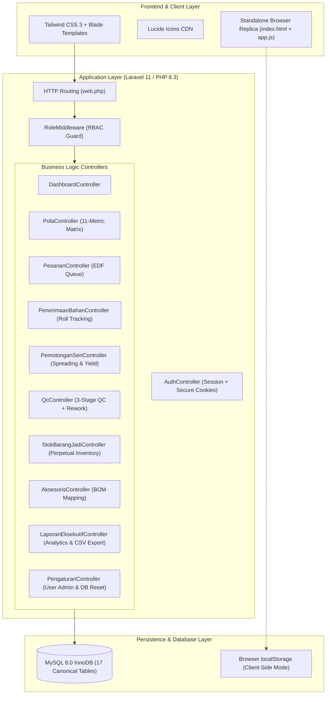
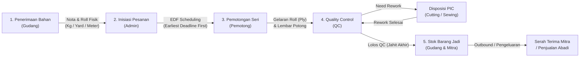
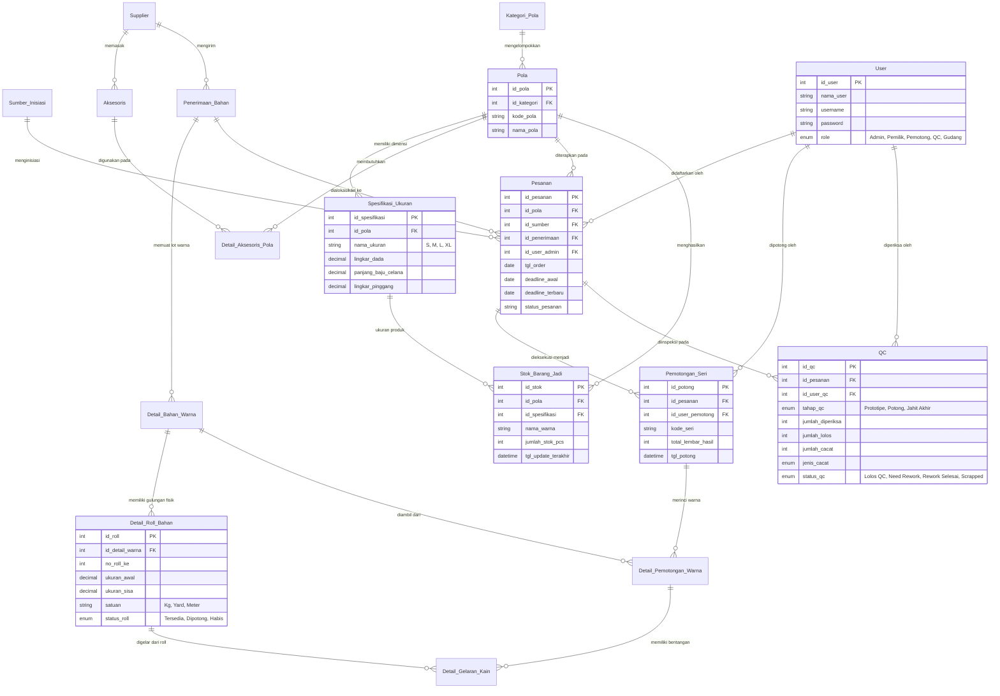
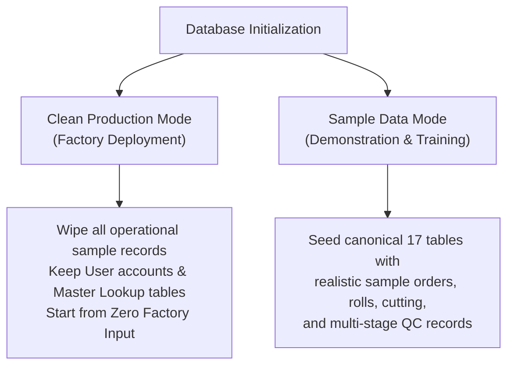

# Bong Garment — CMT Production & Inventory Management System

A full-stack, enterprise-grade production and inventory management web application engineered for **Cut, Make, Trim (CMT)** apparel manufacturing. The system features physical fabric roll tracking (`Detail_Roll_Bahan`), an **Earliest Deadline First (EDF)** dynamic priority cutting schedule (`Pesanan`), an 11-metric garment dimension matrix (`Spesifikasi_Ukuran`), multi-stage Quality Control (`QC`) with rework workflows, and perpetual finished goods inventory (`Stok_Barang_Jadi`).

This repository contains the software implementation for an undergraduate thesis at **Universitas Tarumanagara (UNTAR)**, Faculty of Information Technology, Department of Information Systems.

- **Live App Demo:** [https://thesis.megumin.me](https://thesis.megumin.me)
- **Author & Project Lead:** Luis Febry (NIM: 825220088)
- **Institution:** Universitas Tarumanagara, Jakarta (2026)

---

## System Architecture & Tech Stack

The platform is designed with a **Dual-Execution Architecture**: a production-grade full-stack PHP/MySQL implementation alongside a zero-dependency client-side browser replica.



### Technology Breakdown

| Component | Technology | Version | Purpose |
|---|---|---|---|
| **Backend Framework** | Laravel | `^11.0` | MVC architecture, Eloquent ORM, database migrations, seeders, transaction safety |
| **Runtime Engine** | PHP | `^8.2 / 8.3` | Modern typed PHP with JIT support and strict type enforcement |
| **Relational Database** | MySQL (InnoDB) | `8.0+` | 17 relational tables, foreign key constraints (`ON DELETE RESTRICT ON UPDATE CASCADE`), decimal precision (`DECIMAL(10,2)`) |
| **Styling & Design System** | Tailwind CSS CDN | `3.4+` | Fully responsive utility-first UI, custom color palette (`brand-50` to `brand-900`) |
| **Typography** | Google Fonts | Web | `Inter` (prose UI) & `JetBrains Mono` (codes, batch IDs, measurements) |
| **Iconography** | Lucide Icons | Latest | SVG-based operational icons across all cards, modals, and navigation badges |
| **Client-Side Engine** | Pure JavaScript (ES6+) | Vanilla | Standalone browser mode (`index.html` + `app.js`) with complete 17-table relational simulation |
| **Web Server & Hosting** | Apache / Nginx | Linux | Production deployment via Apache on Heroku (`heroku-php-apache2`), Docker, or Ubuntu VPS |

---

## CMT Production & Inventory Lifecycle Flow

The application coordinates the entire garment factory operational pipeline across 5 specialized divisions:



1. **Inbound Fabric Intake (`Penerimaan_Bahan`):** Individual physical fabric rolls (`Detail_Roll_Bahan`) are registered with initial weight/length (`ukuran_awal`) in `Kg`, `Yard`, or `Meter`.
2. **Order Planning & EDF Queue (`Pesanan`):** Orders are mapped to master patterns (`Pola`), garment size dimensions (`Spesifikasi_Ukuran`), and fabric notes, then queued using the **Earliest Deadline First (EDF)** algorithm.
3. **Spreading & Series Cutting (`Pemotongan_Seri`):** Fabric rolls are spread on cutting tables (`panjang_gelar`, `jumlah_tumpuk`), deducting roll balances (`kain_terpakai`) and updating roll statuses (`Tersedia`, `Dipotong`, `Habis`).
4. **Multi-Stage QC & Rework (`QC`):** Batches are inspected across 3 checkpoints (`Prototipe`, `Potong`, `Jahit Akhir`) with defect classification (`Cacat Potong`, `Cacat Jahit`, `Cacat Bahan`), PIC assignment, and target completion dates.
5. **Perpetual Finished Stock (`Stok_Barang_Jadi`):** Units passing final sewing QC (`Jahit Akhir`) automatically credit finished goods warehouse balances by pattern, size, and color.

---

## Relational Database Schema (17 Canonical Tables)

The database enforces ACID transactions, strict data integrity, and normalized foreign key constraints:



---

## Earliest Deadline First (EDF) Scheduling Algorithm

In garment manufacturing, late delivery penalties and bottlenecked cutting tables require dynamic priority scheduling. The system implements an **Earliest Deadline First (EDF)** queue:

$$\text{Priority Rank} = \operatorname{sort}\Big(\min(\text{deadline\_terbaru}, \text{deadline\_awal})\Big) \quad \text{ASC}$$

- **Dynamic Priority Sorting:** The cutting floor antrean automatically sorts all active orders (`Antrean`, `Pemotongan`) by `COALESCE(deadline_terbaru, deadline_awal) ASC`.
- **Revision Audit Logging:** When an order's delivery deadline is accelerated or delayed by a client, the system records `deadline_terbaru`, timestamp `tgl_perubahan_deadline`, and audit reason `alasan_perubahan_deadline`.
- **One-Click Cutting Setup:** Selecting an order from the EDF queue automatically populates the cutting workstation form with the target pattern, color lot, and associated fabric roll.

---

## Authentication & Role-Based Access Control (RBAC)

The system enforces strict route protection via `RoleMiddleware`. On fresh installation, 5 pre-configured division accounts are provided:

| Role | Default Username | Default Password | Default Display Name | Scope of Permissions |
|---|---|---|---|---|
| **Admin** | `admin` | `admin123` | `Administrator` | **Full Access:** CRUD across all modules, record revisions, and system settings (`/pengaturan`) |
| **Pemilik** | `pemilik` | `pemilik123` | `Pemilik Konveksi` | **Audit Mode (Read-Only):** Dashboard, Gudang, and Executive Reports (all write/edit mutations blocked) |
| **Pemotong** | `pemotong` | `potong123` | `Kepala Pemotong` | Dashboard, EDF Queue, Roll Spreading, and Cutting Series logs |
| **QC** | `qc` | `qc123` | `Petugas Quality Control` | Dashboard, 3-Stage Inspections (`Prototipe`, `Potong`, `Jahit Akhir`), and Rework Completion |
| **Gudang** | `gudang` | `gudang123` | `Kepala Gudang & Inventori` | Dashboard, Fabric Inbound Receipts, Roll Registration, Finished Goods, and Accessory Trims |

### User Management & Password Updates
Administrators can add new staff accounts, modify usernames/roles, and update passwords directly from the web interface at **Pengaturan & Pengguna (`/pengaturan`)**.

### Admin Role View Simulator (`Mode Tampilan`)
When logged in as an **Admin**, a **Mode Tampilan** selector appears in the top navigation header. This allows the administrator to preview navigation visibility and module access from the perspective of other roles without switching accounts or overwriting their logged-in identity.

---

## Database Management: Production Mode vs. Sample Data

The application provides two database initialization modes accessible via the web interface (`/pengaturan`) or the Artisan CLI:



### 1. Web UI Control (`/pengaturan`)
- **Kosongkan Data Operasional Sekarang:** Clears all transactional data (`Pesanan`, `Penerimaan_Bahan`, `Detail_Roll_Bahan`, `Pemotongan_Seri`, `QC`, `Stok_Barang_Jadi`, and optionally Master `Pola`/`Aksesoris`/`Supplier`) while preserving user accounts.
- **Muat Data Contoh:** Re-populates realistic CMT sample data for training or testing without altering custom user credentials.

### 2. Artisan CLI Setup
- **Clean Production Setup (Zero Sample Orders):**
  ```bash
  php artisan migrate:fresh --force
  php artisan db:seed --class=Database\\Seeders\\ProductionBootstrapSeeder --force
  ```
- **Full Sample Dataset (17 Tables Seeded):**
  ```bash
  php artisan migrate:fresh --seed --force
  ```

---

## Local Installation & Deployment

### Option 1: Standard Laravel + Composer (Recommended)
```bash
# 1. Clone repository
git clone https://github.com/luisfebry/Bong-Garment-Thesis.git
cd Bong-Garment-Thesis

# 2. Install dependencies
composer install

# 3. Environment configuration
cp .env.example .env
php artisan key:generate

# 4. Configure database credentials in .env
# DB_HOST=127.0.0.1
# DB_DATABASE=bong_garment
# DB_USERNAME=root
# DB_PASSWORD=secret

# 5. Run migrations & bootstrap default accounts
php artisan migrate --force
php artisan db:seed --class=Database\\Seeders\\ProductionBootstrapSeeder --force

# 6. Start local development server
php artisan serve
```

### Option 2: Docker Setup
```bash
docker compose up -d --build
docker compose exec app php artisan migrate --force
docker compose exec app php artisan db:seed --class=Database\\Seeders\\ProductionBootstrapSeeder --force
```
Application is immediately accessible at `http://localhost:8080`.

### Option 3: Cloud / Heroku Deployment
The repository includes deployment configuration (`Procfile`, `app.json`):
- `Procfile` executes `release: php artisan migrate --force` to apply schema updates without wiping production data.
- The `EnsureDatabaseMigrated` middleware automatically migrates and boots default accounts on first launch if the database is uninitialized.

### Option 4: Standalone Client-Side Preview (Zero Backend)
Simply open `index.html` in any modern web browser. It runs a zero-backend client-side implementation powered by `app.js` and `localStorage`.

---

## Complete Route & Endpoint Reference

| HTTP Method | URI Path | Controller & Action | Allowed Roles | Purpose |
|---|---|---|---|---|
| `GET` / `POST` | `/login`, `/logout` | `AuthController` | Public | Session authentication & credential verification |
| `GET` | `/`, `/dashboard` | `DashboardController@index` | All Authenticated | High-level KPIs, EDF priority queue, and recent QC feed |
| `GET` / `POST` | `/pesanan`, `/pesanan/store` | `PesananController` | Admin | Order intake, pattern selection, and EDF deadline setting |
| `POST` | `/pesanan/{id}/update` | `PesananController@update` | Admin | Edit order details, assign fabric receipt note, or change status |
| `POST` | `/pesanan/{id}/revise-deadline`| `PesananController@reviseDeadline` | Admin | Revise order delivery deadline with audit reason logging |
| `GET` / `POST` | `/penerimaan`, `/penerimaan/store`| `PenerimaanBahanController` | Admin, Gudang | Record supplier delivery note, color groups, and roll metrics |
| `POST` | `/penerimaan/{id}/update` | `PenerimaanBahanController@update` | Admin, Gudang | Edit receipt note details (supplier, delivery date, fabric name) |
| `POST` | `/penerimaan/warna/{id}/update` | `PenerimaanBahanController@updateWarna` | Admin, Gudang | Edit color lot name, code, or unit (`Kg`/`Yard`/`Meter`) |
| `POST` | `/penerimaan/warna/{id}/add-roll`| `PenerimaanBahanController@addRollToWarna`| Admin, Gudang | Add new physical rolls to an existing color lot |
| `POST` | `/penerimaan/roll/{id}/update` | `PenerimaanBahanController@updateRoll` | Admin, Gudang | Edit roll initial/remaining size, unit, or status |
| `POST` | `/supplier` | `PenerimaanBahanController@storeSupplier`| Admin, Gudang | Register new fabric or trims supplier |
| `GET` / `POST` | `/pemotongan`, `/pemotongan/store`| `PemotonganSeriController` | Admin, Pemotong | Record series cutting, spreading parameters, and roll deductions |
| `POST` | `/pemotongan/{id}/update` | `PemotonganSeriController@update` | Admin, Pemotong | Revise cutting series data and readjust roll balances |
| `GET` / `POST` | `/qc`, `/qc/store` | `QcController` | Admin, QC | Record multi-stage QC inspection results (`Prototipe`, `Potong`, `Jahit`) |
| `POST` | `/qc/{id}/update` | `QcController@update` | Admin, QC | Edit QC log quantities, defect type, and status |
| `POST` | `/qc/{id}/complete-rework` | `QcController@completeRework` | Admin, QC | Selesaikan rework dengan timestamp penyelesaian aktual |
| `GET` / `POST` | `/stok`, `/stok/adjust` | `StokBarangJadiController` | Admin, Gudang, Pemilik | Monitor perpetual finished stock & process outbound shipments |
| `POST` | `/stok/{id}/update` | `StokBarangJadiController@update` | Admin, Gudang | Direct revision of finished stock quantities |
| `GET` / `POST` | `/aksesoris`, `/aksesoris/store`| `AksesorisController` | Admin, Gudang | Manage trims inventory and quick mutation adjustments |
| `POST` | `/aksesoris/pola-mapping` | `AksesorisController@storePolaMapping` | Admin, Gudang | Map accessory consumption per garment pattern (BOM) |
| `GET` | `/laporan` | `LaporanEksekutifController@index` | Admin, Pemilik | Executive production analytics, yield metrics, and CSV export |
| `GET` | `/pengaturan` | `PengaturanController@index` | Admin | User account administration, master lookups, and DB reset |
| `POST` | `/pengaturan/user` | `PengaturanController@storeUser` | Admin | Register new staff accounts with assigned roles |
| `POST` | `/pengaturan/user/{id}/update` | `PengaturanController@updateUser` | Admin | Update user display names, usernames, roles, and passwords |
| `POST` | `/pengaturan/reset-operational` | `PengaturanController@resetOperationalData`| Admin | Clear operational data for clean factory production |
| `POST` | `/pengaturan/seed-sample` | `PengaturanController@seedSampleData` | Admin | Re-populate sample CMT dataset for testing |

---

## License

Copyright &copy; 2026 Luis Febry.  
This project is open-sourced software licensed under the [MIT License](LICENSE).
