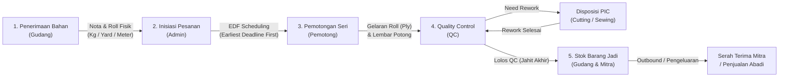
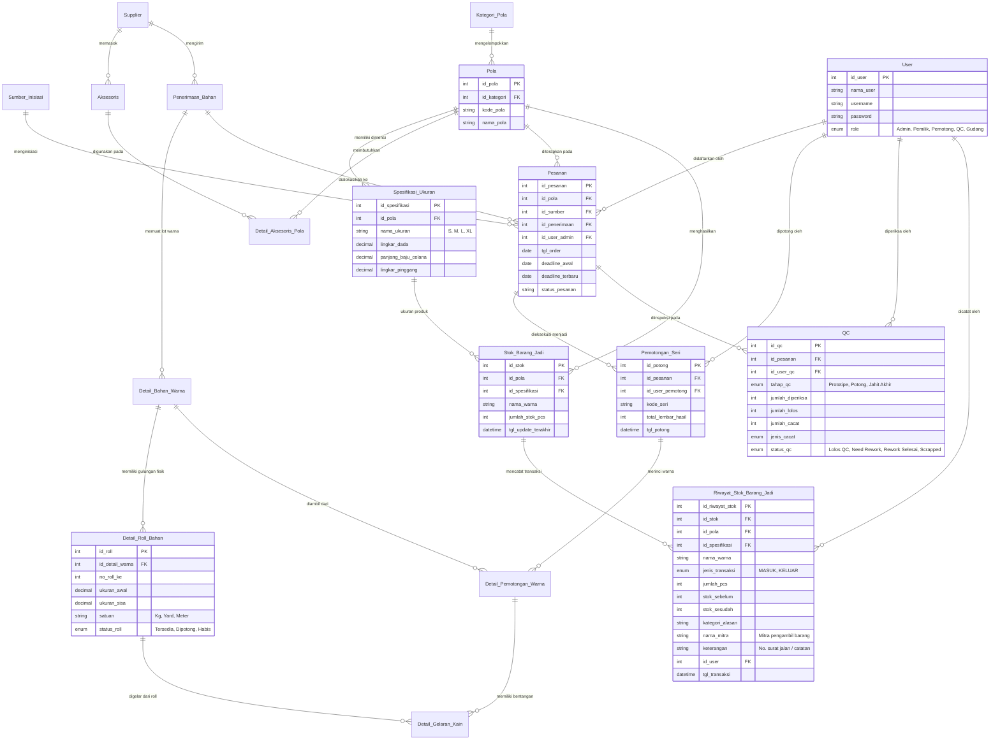
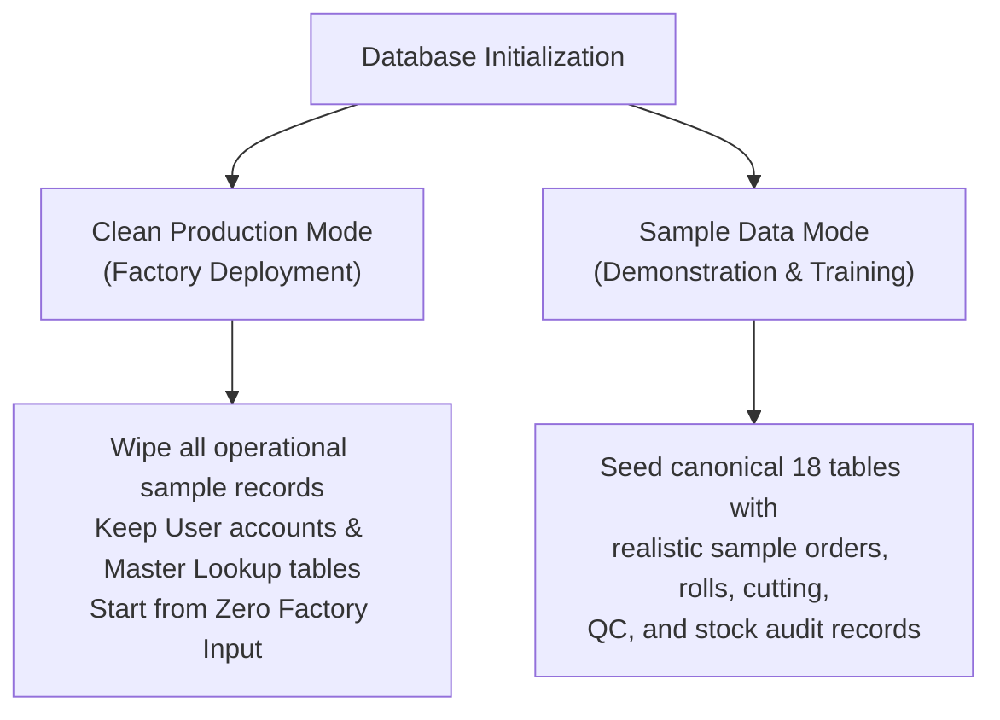

# Bong Garment - CMT Production & Inventory Management System

A full-stack, enterprise-grade production and inventory management web application engineered for **Cut, Make, Trim (CMT)** apparel manufacturing. The system features physical fabric roll tracking (`Detail_Roll_Bahan`), an **Earliest Deadline First (EDF)** dynamic priority cutting schedule (`Pesanan`), an 11-metric garment dimension matrix (`Spesifikasi_Ukuran`), multi-stage Quality Control (`QC`) with rework workflows, perpetual finished goods inventory (`Stok_Barang_Jadi`), and an immutable finished goods transaction ledger with client tracking (`Riwayat_Stok_Barang_Jadi`).

This repository contains the software implementation for an undergraduate thesis at **Universitas Tarumanagara (UNTAR)**, Faculty of Information Technology, Department of Information Systems.

- **Live App Demo:** [https://thesis.megumin.me](https://thesis.megumin.me)
- **Author & Project Lead:** Luis Febry (NIM: 825220088)
- **Institution:** Universitas Tarumanagara, Jakarta (2026)

---

## System Architecture & Tech Stack

The application is engineered as a multi-tier, enterprise-grade production platform. It decouples presentation, route protection, business domain logic, and relational persistence into a high-throughput, maintainable architecture.

```mermaid
flowchart TB
    subgraph ClientLayer["1. Presentation & Client Layer"]
        direction TB
        subgraph UIComponents["User Interface & Templates"]
            Blade["Laravel Blade 11 Engine<br/>(Component-Driven Views & Slots)"]
            Tailwind["Tailwind CSS 3.4 CDN<br/>(Responsive Garment UI Palette)"]
            Lucide["Lucide Icons CDN<br/>(Dynamic SVG Indicators)"]
            Fonts["Google Fonts<br/>(Inter & JetBrains Mono)"]
        end
        subgraph DynamicInteractivity["Client-Side Interactivity"]
            ModalDOM["Modal & Form Controllers<br/>(Multi-Roll Intake, Rework Dispatch, Deadline Revision)"]
            CalcEngine["Real-Time Calculators<br/>(Spreading Ply, Fabric Yield & Consumption)"]
            ExportEngine["Reporting Exporter<br/>(Dynamic CSV & @media print Stylesheets)"]
        end
        UIComponents --- DynamicInteractivity
    end

    subgraph SecurityLayer["2. Security & Middleware Pipeline"]
        direction LR
        CSRF["VerifyCsrfToken<br/>(Cross-Site Request Forgery Protection)"]
        SessionGuard["Session Auth Guard<br/>(Stateful Secure Session Cookies)"]
        RBAC["RoleMiddleware<br/>(5-Role Access Control Guard)"]
        AutoMigrate["EnsureDatabaseMigrated<br/>(Zero-Downtime Auto-Init Middleware)"]
        CSRF --> SessionGuard --> RBAC --> AutoMigrate
    end

    subgraph AppLayer["3. Application & Controller Layer (Laravel 11 / PHP 8.3)"]
        direction TB
        Router["HTTP Routing Engine (routes/web.php)"]
        
        subgraph DomainControllers["Operational Domain Controllers"]
            AuthC["AuthController<br/>(User Session & Auth)"]
            DashC["DashboardController<br/>(Factory KPIs & EDF Queue)"]
            PesananC["PesananController<br/>(Order Intake & Audit Revisions)"]
            PolaC["PolaController<br/>(11-Metric Pattern Matrix)"]
            PenerimaanC["PenerimaanBahanController<br/>(Multi-Roll Physical Intake)"]
            PotongC["PemotonganSeriController<br/>(Spreading, Ply & Consumption)"]
            QcC["QcController<br/>(3-Stage QC & Rework Dispatch)"]
            StokC["StokBarangJadiController<br/>(Perpetual Stock & Outbound)"]
            AccC["AksesorisController<br/>(Trims Stock & BOM Mapping)"]
            LaporanC["LaporanEksekutifController<br/>(Yield Metrics & Analytics)"]
            SettingC["PengaturanController<br/>(Staff RBAC & Database Modes)"]
        end
        Router --> DomainControllers
    end

    subgraph DataLayer["4. Persistence & Database Layer (MySQL 8.0 InnoDB)"]
        direction TB
        ORM["Eloquent ORM & Schema Builder<br/>(ACID Transactions via DB::transaction)"]
        
        subgraph CanonicalTables["18 Canonical Relational Tables"]
            direction LR
            T_Users["User<br/>(5 RBAC Roles)"]
            T_Pola["Pola & Kategori<br/>(11-Metric Dimensi)"]
            T_Pesanan["Pesanan & Sumber<br/>(EDF Priority Sorting)"]
            T_Roll["Penerimaan & Roll Fisik<br/>(Kg / Yard / Meter)"]
            T_Potong["Pemotongan & Gelaran<br/>(Ply & Yield Tracking)"]
            T_QC["Inspeksi QC & Rework<br/>(3-Stage Defect Logs)"]
            T_Stok["Stok Barang Jadi<br/>(Perpetual Warehousing)"]
            T_Riwayat["Riwayat Stok & Mitra<br/>(Outbound & Inbound Ledger)"]
            T_Acc["Aksesoris & BOM<br/>(Per-Pattern Trim Usage)"]
        end
        ORM --> CanonicalTables
    end

    subgraph InfraLayer["5. Infrastructure, DevOps & Cloud Deployment"]
        direction LR
        Docker["Docker & Docker Compose<br/>(Multi-Arch PHP 8.3 Apache/Nginx)"]
        Heroku["Heroku Cloud PaaS<br/>(heroku-php-apache2 Procfile)"]
        ArtisanCLI["Artisan CLI Suite<br/>(Production vs Sample Seeders)"]
    end

    ClientLayer ==> SecurityLayer
    SecurityLayer ==> AppLayer
    AppLayer ==> DataLayer
    DataLayer -.-> InfraLayer
```



### In-Depth Technology Breakdown

| Category | Component / Tool | Version / Spec | Architecture & Operational Role |
|---|---|---|---|
| **Backend Framework** | Laravel | `^11.0` | MVC architecture, dependency injection service container, Eloquent ORM, database migrations, seeders, and atomic transaction handling |
| **Runtime Engine** | PHP | `^8.2 / 8.3` | High-performance modern PHP with strict typing, constructor promotion, enums, match expressions, and JIT compilation |
| **Relational Database** | MySQL (InnoDB) | `8.0+` | Normalized 18-table relational schema, strict foreign keys (`ON DELETE RESTRICT ON UPDATE CASCADE`), decimal precision (`DECIMAL(10,2)` for physical units) |
| **Security & Authorization** | Laravel Middleware | Custom RBAC | Role-Based Access Control (`RoleMiddleware`) guarding endpoints per division; CSRF verification; secure HTTP-only cookies; database bootstrap guard (`EnsureDatabaseMigrated`) |
| **Frontend Templating** | Laravel Blade | Engine 11 | Component-driven server-side rendering, layout inheritance (`layouts/app.blade.php`), slot injection, and modular view stack pushes (`@push('scripts')`) |
| **Styling & Design System** | Tailwind CSS CDN | `3.4+` | Utility-first responsive design system, custom manufacturing color palette (`brand-50` to `brand-900`, `emerald`, `amber`, `rose`), flexbox and CSS grid layouts |
| **Typography** | Google Fonts | Web | `Inter` (high-readability UI typography) & `JetBrains Mono` (tabular numbers, batch roll IDs, and physical measurement metrics) |
| **Iconography** | Lucide Icons | Latest CDN | Scalable SVG operational icons embedded across sidebar navigation, status badges, and action buttons |
| **Frontend Interactivity** | Pure JavaScript | ECMAScript 2023 | Interactive modal management (multi-roll intake, rework assignment, deadline revisions), real-time cutting yield calculators, dynamic unit switchers, and live search filters |
| **Document & Data Export** | CSV & Browser Print | Dynamic Stream | Instant CSV export with dynamic headers for production analytics, plus formatted `@media print` stylesheets for executive factory reports |
| **Containerization** | Docker & Compose | Multi-Stage | Portable containerized execution (`Dockerfile`, `docker-compose.yml`) bundling PHP 8.3-FPM, Apache/Nginx web server, and MySQL database container |
| **Cloud Deployment** | Heroku Cloud PaaS | Linux 64-bit | Live production hosting with `heroku-php-apache2` web server routing, automatic Procfile release migrations (`php artisan migrate --force`), and JawsDB MySQL integration |
| **Database Initialization** | Laravel Seeders | Dual Mode | Dedicated production seeder (`ProductionBootstrapSeeder` for factory go-live with zero sample data) and evaluation seeder (`DatabaseSeeder` with realistic 18-table sample data) |

---

## CMT Production & Inventory Lifecycle Flow

The application coordinates the entire garment factory operational pipeline across 5 specialized divisions:



1. **Inbound Fabric Intake (`Penerimaan_Bahan`):** Individual physical fabric rolls (`Detail_Roll_Bahan`) are registered with initial weight/length (`ukuran_awal`) in `Kg`, `Yard`, or `Meter`.
2. **Order Planning & EDF Queue (`Pesanan`):** Orders are mapped to master patterns (`Pola`), garment size dimensions (`Spesifikasi_Ukuran`), and fabric notes, then queued using the **Earliest Deadline First (EDF)** algorithm.
3. **Spreading & Series Cutting (`Pemotongan_Seri`):** Fabric rolls are spread on cutting tables (`panjang_gelar`, `jumlah_tumpuk`), deducting roll balances (`kain_terpakai`) and updating roll statuses (`Tersedia`, `Dipotong`, `Habis`).
4. **Multi-Stage QC & Rework (`QC`):** Batches are inspected across 3 checkpoints (`Prototipe`, `Potong`, `Jahit Akhir`) with defect classification (`Cacat Potong`, `Cacat Jahit`, `Cacat Bahan`), PIC assignment, and target completion dates.
5. **Perpetual Finished Stock & Transaction Ledger (`Stok_Barang_Jadi` & `Riwayat_Stok_Barang_Jadi`):** Units passing final sewing QC (`Jahit Akhir`) automatically credit finished goods warehouse balances. Outbound transactions (client shipments / store retail) log immutable debit records capturing the exact recipient Mitra, quantity, and timestamp.

---

## Relational Database Schema (18 Canonical Tables)

The database enforces ACID transactions, strict data integrity, and normalized foreign key constraints:



---

## Earliest Deadline First (EDF) Scheduling Algorithm

In garment manufacturing, late delivery penalties and bottlenecked cutting tables require dynamic priority scheduling. The system implements an **Earliest Deadline First (EDF)** queue:

$$
\text{Effective Deadline} = \min(\text{deadline-terbaru}, \text{deadline-awal})
$$

```sql
-- Query Algoritma Antrean Meja Potong EDF
SELECT id_pesanan, id_pola, nama_mitra, deadline_awal, deadline_terbaru,
       COALESCE(deadline_terbaru, deadline_awal) AS deadline_prioritas_edf
FROM Pesanan
WHERE status_pesanan IN ('Antrean', 'Pemotongan')
ORDER BY COALESCE(deadline_terbaru, deadline_awal) ASC;
```

- **Dynamic Priority Sorting:** The cutting floor antrean automatically sorts all active orders (`Antrean`, `Pemotongan`) by `COALESCE(deadline_terbaru, deadline_awal) ASC`.
- **Revision Audit Logging:** When an order's delivery deadline is accelerated or delayed by a client, the system records `deadline_terbaru`, timestamp `tgl_perubahan_deadline`, and audit reason `alasan_perubahan_deadline`.
- **One-Click Cutting Setup:** Selecting an order from the EDF queue automatically populates the cutting workstation form with the target pattern, color lot, and associated fabric roll.

---

## Authentication & Role-Based Access Control (RBAC)

The system enforces strict route protection via `RoleMiddleware`. On fresh installation, 5 pre-configured division accounts are provided:

| Role | Default Username | Default Password | Default Display Name | Scope of Permissions |
|---|---|---|---|---|
| **Admin** | `admin` | `admin123` | `Administrator` | **Full Access:** CRUD across all modules, record revisions, and system settings (`/pengaturan`) |
| **Pemilik** | `pemilik` | `pemilik123` | `Pemilik Konveksi` | **Audit Mode (Read-Only):** Dashboard, Gudang, and Executive Reports (all write/edit mutations blocked) |
| **Pemotong** | `pemotong` | `potong123` | `Kepala Pemotong` | Dashboard, EDF Queue, Roll Spreading, and Cutting Series logs |
| **QC** | `qc` | `qc123` | `Petugas Quality Control` | Dashboard, 3-Stage Inspections (`Prototipe`, `Potong`, `Jahit Akhir`), and Rework Completion |
| **Gudang** | `gudang` | `gudang123` | `Kepala Gudang & Inventori` | Dashboard, Fabric Inbound Receipts, Roll Registration, Finished Goods, and Accessory Trims |

### User Management & Password Updates
Administrators can add new staff accounts, modify usernames/roles, and update passwords directly from the web interface at **Pengaturan & Pengguna (`/pengaturan`)**.

### Admin Role View Simulator (`Mode Tampilan`)
When logged in as an **Admin**, a **Mode Tampilan** selector appears in the top navigation header. This allows the administrator to preview navigation visibility and module access from the perspective of other roles without switching accounts or overwriting their logged-in identity.

---

## Database Management: Production Mode vs. Sample Data

The application provides two database initialization modes accessible via the web interface (`/pengaturan`) or the Artisan CLI:



### 1. Web UI Control (`/pengaturan`)
- **Kosongkan Data Operasional Sekarang:** Clears all transactional data (`Pesanan`, `Penerimaan_Bahan`, `Detail_Roll_Bahan`, `Pemotongan_Seri`, `QC`, `Stok_Barang_Jadi`, `Riwayat_Stok_Barang_Jadi`, and optionally Master `Pola`/`Aksesoris`/`Supplier`) while preserving user accounts.
- **Muat Data Contoh:** Re-populates realistic CMT sample data for training or testing without altering custom user credentials.

### 2. Artisan CLI Setup
- **Clean Production Setup (Zero Sample Orders):**
  ```bash
  php artisan migrate:fresh --force
  php artisan db:seed --class=Database\\Seeders\\ProductionBootstrapSeeder --force
  ```
- **Full Sample Dataset (18 Tables Seeded):**
  ```bash
  php artisan migrate:fresh --seed --force
  ```

---

## Local Installation & Deployment

### Option 1: Standard Laravel + Composer (Recommended)
```bash
# 1. Clone repository
git clone https://github.com/luisfebry/Bong-Garment-Thesis.git
cd Bong-Garment-Thesis

# 2. Install dependencies
composer install

# 3. Environment configuration
cp .env.example .env
php artisan key:generate

# 4. Configure database credentials in .env
# DB_HOST=127.0.0.1
# DB_DATABASE=bong_garment
# DB_USERNAME=root
# DB_PASSWORD=secret

# 5. Run migrations & bootstrap default accounts
php artisan migrate --force
php artisan db:seed --class=Database\\Seeders\\ProductionBootstrapSeeder --force

# 6. Start local development server
php artisan serve
```

### Option 2: Docker Setup
```bash
docker compose up -d --build
docker compose exec app php artisan migrate --force
docker compose exec app php artisan db:seed --class=Database\\Seeders\\ProductionBootstrapSeeder --force
```
Application is immediately accessible at `http://localhost:8080`.

### Option 3: Cloud / Heroku Deployment

The repository includes complete production cloud configuration for **Heroku PaaS** with **JawsDB MySQL**:

```procfile
web: vendor/bin/heroku-php-apache2 public/
release: php artisan migrate --force
```

#### Required Heroku Config Vars
Environment variables are managed in the cloud provider console (**Heroku Dashboard &rarr; Settings &rarr; Config Vars**):
- `APP_ENV`: `production`
- `APP_DEBUG`: `false` (or `true` during thesis evaluation)
- `APP_KEY`: Application encryption key generated via `php artisan key:generate`
- `APP_NAME`: `Bong Garment CMT`
- `DB_CONNECTION`: `mysql`
- `JAWSDB_URL`: Provisioned automatically by attaching the JawsDB MySQL add-on
- `LOG_CHANNEL`: `errorlog`
- `SESSION_DRIVER`: `cookie`

#### Automated Release Phase & Self-Healing Database
- Heroku's **Release Phase** executes `php artisan migrate --force` immediately following container builds, applying schema updates without downtime or data destruction.
- The `EnsureDatabaseMigrated` application middleware provides automatic self-healing: if an empty database is connected, it provisions the canonical 18-table relational schema and registers default administrative credentials automatically on first launch.

---

## Complete Route & Endpoint Reference

| HTTP Method | URI Path | Controller & Action | Allowed Roles | Purpose |
|---|---|---|---|---|
| **Authentication & Dashboard** | | | | |
| `GET` / `POST` | `/login`, `/logout` | `AuthController` | Public | Session authentication & credential verification |
| `GET` | `/`, `/dashboard` | `DashboardController@index` | All Authenticated | High-level KPIs, EDF cutting priority queue, and recent QC feed |
| **Pola & 11-Metric Specifications** | | | | |
| `GET` | `/pola` | `PolaController@index` | Admin, Pemotong, Gudang | Garment pattern catalogue with 11-metric size tables |
| `POST` | `/pola` | `PolaController@store` | Admin, Pemotong, Gudang | Register new garment master pattern & size matrix |
| `GET` | `/pola/{id}` | `PolaController@show` | Admin, Pemotong, Gudang | View pattern details and associated size specifications |
| `POST` | `/pola/{id}/update` | `PolaController@update` | Admin, Pemotong, Gudang | Update pattern code, category, and size metric values |
| **Pesanan & EDF Deadline Management** | | | | |
| `GET` | `/pesanan` | `PesananController@index` | Admin | Production order list and intake form |
| `POST` | `/pesanan` | `PesananController@store` | Admin | Register new production order with initial EDF deadline |
| `POST` | `/pesanan/{id}/update` | `PesananController@update` | Admin | Edit order parameters, assign fabric receipt note, or change status |
| `POST` | `/pesanan/{id}/revise-deadline` | `PesananController@reviseDeadline` | Admin | Revise order delivery deadline with immutable audit reason logging |
| `POST` | `/pesanan/{id}/status` | `PesananController@updateStatus` | Admin | Update order manufacturing lifecycle status |
| **Penerimaan Bahan & Roll Tracking** | | | | |
| `GET` | `/penerimaan` | `PenerimaanBahanController@index` | Admin, Gudang | Fabric receipt notes, color batches, and individual roll inventory |
| `POST` | `/penerimaan` | `PenerimaanBahanController@store` | Admin, Gudang | Record supplier delivery note, color groups, and roll metrics |
| `POST` | `/penerimaan/{id}/update` | `PenerimaanBahanController@update` | Admin, Gudang | Edit receipt note details (supplier, delivery date, fabric name) |
| `POST` | `/penerimaan/warna/{id}/update` | `PenerimaanBahanController@updateWarna` | Admin, Gudang | Edit color lot name, code, or unit (`Kg`/`Yard`/`Meter`) |
| `POST` | `/penerimaan/warna/{id}/add-roll` | `PenerimaanBahanController@addRollToWarna` | Admin, Gudang | Add new physical rolls to an existing color lot |
| `POST` | `/penerimaan/roll/{id}/update` | `PenerimaanBahanController@updateRoll` | Admin, Gudang | Edit roll initial/remaining size, unit, or status (`Tersedia`/`Dipotong`/`Habis`) |
| **Master Lookups (Operational Direct Access)** | | | | |
| `POST` | `/supplier` | `PenerimaanBahanController@storeSupplier` | Admin, Gudang, Pemotong | Register new fabric or trims supplier directly from input forms |
| `POST` | `/supplier/{id}/update` | `PengaturanController@updateSupplier` | Admin, Gudang, Pemotong | Edit supplier business name, contact info, and address |
| `POST` | `/supplier/{id}/delete` | `PengaturanController@destroySupplier` | Admin, Gudang, Pemotong | Delete supplier record (guarded against active foreign keys) |
| `POST` | `/kategori` | `PengaturanController@storeKategori` | Admin, Gudang, Pemotong | Register garment pattern category directly from pattern modal |
| `POST` | `/kategori/{id}/update` | `PengaturanController@updateKategori` | Admin, Gudang, Pemotong | Edit pattern category name |
| `POST` | `/kategori/{id}/delete` | `PengaturanController@destroyKategori` | Admin, Gudang, Pemotong | Delete pattern category |
| `POST` | `/sumber` | `PengaturanController@storeSumber` | Admin, Gudang, Pemotong | Register client order source directly from order intake form |
| `POST` | `/sumber/{id}/update` | `PengaturanController@updateSumber` | Admin, Gudang, Pemotong | Edit order source name |
| `POST` | `/sumber/{id}/delete` | `PengaturanController@destroySumber` | Admin, Gudang, Pemotong | Delete order source |
| **Pemotongan Seri & Gelaran Kain** | | | | |
| `GET` | `/pemotongan` | `PemotonganSeriController@index` | Admin, Pemotong | Cutting queue sorted by EDF deadline and cutting series records |
| `POST` | `/pemotongan` | `PemotonganSeriController@store` | Admin, Pemotong | Execute cutting series, spread rolls, and deduct roll balances |
| `POST` | `/pemotongan/{id}/update` | `PemotonganSeriController@update` | Admin, Pemotong | Revise cutting series data and recalculate roll balance deductions |
| **Quality Control Multi-Stage & Rework** | | | | |
| `GET` | `/qc` | `QcController@index` | Admin, QC | Multi-stage inspection queue (`Prototipe`, `Potong`, `Jahit Akhir`) |
| `POST` | `/qc` | `QcController@store` | Admin, QC | Record QC inspection batch (passed count, defects, rework PIC) |
| `POST` | `/qc/{id}/update` | `QcController@update` | Admin, QC | Edit QC log quantities, defect type, and status |
| `POST` | `/qc/{id}/complete-rework` | `QcController@completeRework` | Admin, QC | Selesaikan rework dengan timestamp penyelesaian aktual |
| **Stok Barang Jadi & Riwayat Transaksi Mitra** | | | | |
| `GET` | `/stok` | `StokBarangJadiController@index` | Admin, Gudang, Pemilik | Monitor perpetual finished stock & immutable transaction history |
| `POST` | `/stok/adjust` | `StokBarangJadiController@adjustStock` | Admin, Gudang | Process outbound shipment with `nama_mitra` tracking & audit trail |
| `POST` | `/stok/{id}/update` | `StokBarangJadiController@update` | Admin, Gudang | Direct revision of finished stock balance |
| **Aksesoris & Bill of Materials (BOM)** | | | | |
| `GET` | `/aksesoris` | `AksesorisController@index` | Admin, Gudang | Manage trims inventory and BOM pattern accessory allocations |
| `POST` | `/aksesoris` | `AksesorisController@store` | Admin, Gudang | Register new trims or accessory stock item |
| `POST` | `/aksesoris/{id}/stock` | `AksesorisController@updateStock` | Admin, Gudang | Quick stock addition/deduction for trims inventory |
| `POST` | `/aksesoris/{id}/update` | `AksesorisController@update` | Admin, Gudang | Edit accessory name, supplier, or unit |
| `POST` | `/aksesoris/{id}/delete` | `AksesorisController@destroy` | Admin, Gudang | Delete accessory item |
| `POST` | `/aksesoris/pola-mapping` | `AksesorisController@storePolaMapping` | Admin, Gudang | Map accessory requirement per garment piece (BOM) |
| `POST` | `/aksesoris/pola-mapping/delete` | `AksesorisController@destroyPolaMapping` | Admin, Gudang | Remove BOM pattern accessory requirement |
| **Executive Reports & Data Export** | | | | |
| `GET` | `/laporan` | `LaporanEksekutifController@index` | Admin, Pemilik | Executive production analytics, yield metrics, and CSV export |
| **Pengaturan Sistem & User Administration** | | | | |
| `GET` | `/pengaturan` | `PengaturanController@index` | Admin | User account administration, master lookups, and DB reset |
| `POST` | `/pengaturan/user` | `PengaturanController@storeUser` | Admin | Register new staff account with assigned role |
| `POST` | `/pengaturan/user/{id}/update` | `PengaturanController@updateUser` | Admin | Update user display names, usernames, roles, and passwords |
| `POST` | `/pengaturan/user/{id}/delete` | `PengaturanController@destroyUser` | Admin | Delete user account (guarded against self-deletion) |
| `POST` | `/pengaturan/reset-operational` | `PengaturanController@resetOperationalData` | Admin | Clear operational data for clean factory production |
| `POST` | `/pengaturan/seed-sample` | `PengaturanController@seedSampleData` | Admin | Re-populate realistic 18-table CMT sample dataset |

---

## License

Copyright &copy; 2026 Luis Febry.  
This project is open-sourced software licensed under the [MIT License](LICENSE).
